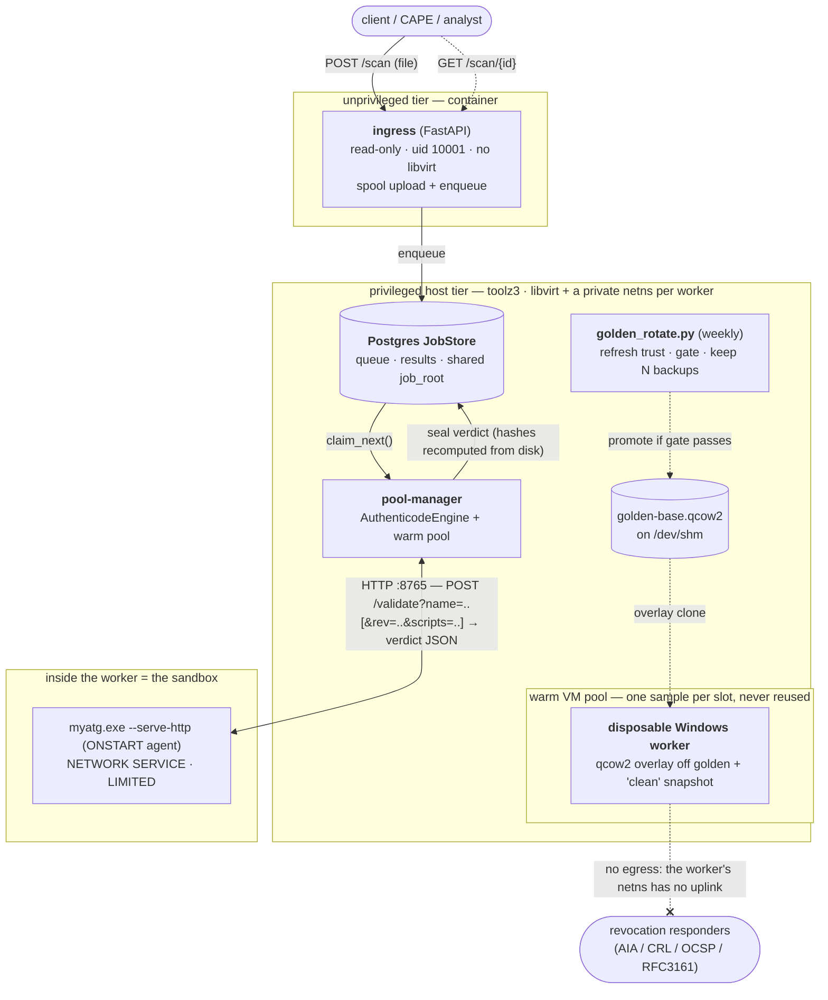

# win-validator

**Windows code-signature validation for untrusted files, run inside disposable KVM Windows
workers** — a [blastbox](https://github.com/wmetcalf/blastbox) engine that wraps the
[myatg](https://github.com/wmetcalf/myatg) Authenticode validator and returns a typed,
host-sealed verdict you can trust.

You hand it a suspect `.exe` / `.dll` / `.msi` / `.cab` / script / `.rdp`; it validates the
signature, certificate chain, timestamp, and a cert-graveyard (known-bad) lookup **on real
Windows** — but never on your host and never in a VM that has seen another sample.

## Where it sits

Three repos, one job each:

| Repo | Role |
|------|------|
| [**blastbox**](https://github.com/wmetcalf/blastbox) | the framework — job store, warm worker pool, disposable **libvirt/KVM VM-per-job** runtime, output-trust sealing. Ships *no* domain engines. |
| [**myatg**](https://github.com/wmetcalf/myatg) | the leaf tool — a self-contained native Windows Authenticode/catalog/script/RDP validator (`myatg.exe`). Runs *inside* the worker. |
| **win-validator** *(this repo)* | the **`authenticode` blastbox engine** + a fan-out orchestrator. Turns "run myatg in a disposable Windows VM" into a blastbox `Engine`, and wires the golden-image build + rolling refresh + least-privilege deployment around it. |

## How it works



1. **ingress** (an unprivileged, read-only container) takes the upload, spools it to a shared
   `job_root`, and enqueues a job in the blastbox **JobStore** (Postgres). It holds no `root`,
   no libvirt socket — a web-stack compromise is contained to that box.
2. The **pool-manager** (host systemd, the only privileged tier) claims the job and runs the
   `authenticode` engine, which hands the file to a **warm Windows worker** from the pool.
3. The worker is a **libvirt qcow2 overlay clone** off the golden base with an internal `clean`
   snapshot. A baked-in guest agent (`myatg.exe`, running as **NETWORK SERVICE, unprivileged**)
   validates the file over an HTTP `POST /validate` call and returns myatg's JSON verdict
   (`AUTHENTICODE_REV`/`AUTHENTICODE_SCRIPTS` ride along as `?rev=`/`?scripts=`: the scan request's own
   `rev`/`scripts` form fields when it sets them, else the engine's environment).
4. blastbox **re-seals** that output from disk (recomputing every hash/size, confining paths)
   before a byte of it is trusted, and writes it back as the job result. The client polls
   `GET /scan/{id}`.

Why the worker is a *VM* and not a container like blastbox's other engines: the validator needs
**real Windows** WinVerifyTrust / catalog / X509 semantics, so the disposable unit is a full-OS
libvirt VM and the engine runs **host-side**, driving it over HTTP — the VM *is* the sandbox.

## Disposable workers — the recycle model

A worker handles **one sample per slot and is never reused across samples dirty**. Reset is a fast
in-VM snapshot revert, not a reboot:

```mermaid
stateDiagram-v2
    [*] --> Provision: overlay clone off golden base
    Provision --> Warm: boot · start agent · sync clock (domtime)<br/>smoke-test · snapshot-create-as 'clean'
    Warm --> Validating: claim one sample
    Validating --> Warm: virsh snapshot-revert 'clean' (~5–8s)<br/>[every K jobs — jobs_per_recycle]
    Warm --> Respawn: 2 consecutive failures to REACH the agent on one worker (connection refused / unreachable)<br/>(blastbox max_consecutive_failures — the worker is destroyed and a fresh overlay booted, no rotation involved. An agent that answered with HTTP — an error status, a bad or oversize body — is the sample's evidence; one that accepted the connection and then stalled, reset or died is nobody's: the worker is snapshot-reverted either way and never evicted for it)
    Respawn --> Warm
    Warm --> [*]: golden rotation (the pool restarts on the new base)<br/>no rebuild ceiling of its own: max_jobs_per_slot is 0 (deploy/vmcompose.yml)
```



- **`snapshot-revert`** restores a warm baseline (agent up, CRL cache primed) in ~5–8 s, wiping any
  per-sample contamination — a parser-exploit blast radius of at most `K` samples in one VM before it
  resets. Real UTC time is re-synced on every restore (`virsh domtime --time`), so a restored worker
  always validates against **now** (validity windows + revocation freshness are trust-critical).
- The base lives on **`/dev/shm`** (RAM), so overlays boot and revert at memory speed and identical
  clone pages dedupe via KSM.

## Rolling golden — freshness, *not* temporal trust

`golden_rotate.py` keeps the golden image **fresh** and keeps the last N as **rollback backups**:

```
build_candidate()  private copy of the PROMOTED golden --overlay--> myatg.exe --refresh
                   (disallowed kill-list + CRL cache + roots/CTL via syncWithWU) --> flatten
                   (every GOLDEN_MAX_CHAIN cycles, or with GOLDEN_REBAKE_FROM=master, the cycle is instead the
                   full golden_build bake from the packer master — the Disallowed store is add-only, so the
                   chain of goldens is reset from the pristine image; see deploy/README.md)
validate_golden()  boot a throwaway worker off the candidate
                   GATE:  benign binary == Valid  AND  known-revoked in Revoked|Distrusted
rotate()           back up current golden (keep last N) --> promote candidate --> restart pool-manager
```

> **The hourly/daily/weekly/monthly ladder is a backup rotation, not "validate as-of T."** Workers
> sync real time on restore, so validity windows are judged against *now* (revocation comes from the
> golden's cache — workers have no egress, see below); the only
> thing an old snapshot freezes is trust-store state, which is a **liability if stale** (you want the
> *freshest* disallowed list). So old goldens are rollback targets for a bad re-bake — nothing more.

A candidate is promoted **only if it passes the gate**, so a wedged Windows-Update re-bake or a
corrupted image is rejected and the current golden is kept.

## Worker network isolation — no host firewall rules

Every VM worker's NIC is a tap device in its **own network namespace** (`wvn-<slot>`, see
`winval_blastbox/netns_isolation.py`). The namespace holds `lo`, the tap, the host side of the tap
(`AUTHENTICODE_AGENT_CALLER`, default `192.168.122.1` — the one address the golden's agent-port firewall
rule admits) and a dnsmasq answering the guest's DHCP (no DNS; run as nobody with `CAP_NET_RAW` only and
no_new_privs), and **nothing else: no uplink, no route**.
So, by construction rather than by rule:

- the guest cannot reach the host — none of the host's addresses exist in its namespace (the ingress on
  8099, Postgres, docker bridges, the LAN);
- the guest cannot reach a sibling — there is no shared bridge, each worker has its own namespace;
- the guest cannot reach the internet — no egress at all.

The pool-manager reaches the guest's agent by opening its socket *inside* that namespace. Nothing touches the
host's nftables/iptables/ebtables, loads `br_netfilter`, sets a host sysctl, or creates a libvirt network or
nwfilter: `nft list ruleset` is unchanged by a worker's whole life. The rooter-era exits (`direct`, `drop`,
`openvpn`, `wireguard`, `tor`, `inetsim`) and their knobs installed host iptables chains; they are removed and
refused by name at start (`AUTHENTICODE_EXIT` must be unset or `none`).

**Consequence: no live revocation.** WinVerifyTrust/X509Chain cannot fetch AIA/CRL/OCSP/RFC3161 URLs, so
revocation is answered from the golden's baked CRL/OCSP cache or not at all — the engine reports a `Valid`
whose revocation was not checked as `ValidRevocationUnchecked`, never as `Valid` — in its revocation-aware `status`;
the raw myatg verdict it also carries still says `Valid`, so a consumer must read `status` (Loadout's mapper does from
its 2026-11 engine-contract release on). Controlled egress
(an anonymizing, web-only path) is a follow-up that must not need host firewall rules.

## Repo layout

```
winval_blastbox/   the authenticode blastbox Engine + host runner + VM pool + FastAPI orchestrator
                   (engine.py · host_runner.py · vm_pool.py · orchestrator.py)
golden-packer/     Packer (QEMU) builder for the WS2025-Core golden qcow2 (provisioners, autounattend)
golden_build.py    reproducible in-guest bake pipeline (ngen · qemu-ga · compile myatg · refresh trust)
golden_rotate.py   rolling freshness re-bake + gate + rollback backups
deploy/            the privilege split — ingress container + host pool-manager + Postgres + systemd units
```

## Engine contract

[`blastbox-engine.toml`](blastbox-engine.toml) states what the `authenticode` engine emits: the
one `authenticode.json` artifact, the flat `record` payload and its fields, the verdict statuses
and other findings a consumer turns into detections, Loadout's mapper, and a `[[gaps]]` list of
what the output cannot express today. `tests/test_engine_contract.py` runs the real engine and host
runner (the VM pool replays recorded myatg verdicts) and checks every result against it; it skips
on a blastbox release that predates the checker.

```sh
python -m blastbox.contract.engine_contract validate blastbox-engine.toml
python -m blastbox.contract.engine_contract check blastbox-engine.toml <output>/metadata.json
```

## Quickstart

Full bring-up (the ingress/pool-manager privilege split, the rolling-golden timer) is in
[`deploy/README.md`](deploy/README.md). The single-host orchestrator:

```sh
# on the libvirt host, AS ROOT (each worker's network namespace needs it) — warms the VM pool at startup
uvicorn winval_blastbox.orchestrator:app --host 127.0.0.1 --port 8099

curl -F file=@suspect.dll 'http://127.0.0.1:8099/scan'   # -> {job_id, status: queued}
curl http://127.0.0.1:8099/scan/<job_id>                 # -> per-engine verdict(s)
```

`GET /cert/{tbs_sha256}` on the orchestrator returns every scanned file (its own in-memory store) whose signer or
chain carries that cert; the ingress's `/cert/{tbs}` searches its store's newest 2000 scans only and says so
(`scanned` / `truncated`), see `deploy/README.md`.

## Status

- **`authenticode` engine + orchestrator: built and validated end-to-end** (engine → myatg VM pool
  → sealed envelope; verdicts match the reference corpus). myatg is baked into the golden (no per-boot
  compile); the disposable-VM primitive is upstreamed into blastbox's `libvirt_vm` runtime.
- **Follow-ups:** the designed **ember-legacy / ember-2024** ML
  engines (the orchestrator already fans out to them and returns per-engine verdicts side-by-side —
  it reports components, not a single opinion).

## Security note

This project exists to handle **untrusted, frequently-malicious files**. It never *executes* a
sample — it only parses signatures (WinVerifyTrust / catalog / SignedCms) — so residual risk is a
signature-*parser* exploit, contained to a throwaway VM that resets every few jobs and has no network beyond its own
private namespace (above).
Do not repurpose the workers to detonate samples without revisiting that model. Malware corpora,
VM images, keys, and infra config are excluded from this repo by `.gitignore` — keep them out.
